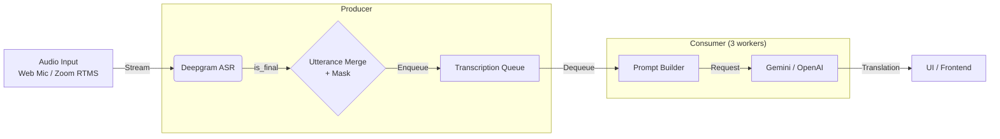

# リアルタイム同時翻訳システム アーキテクチャ設計書

## 1. 概要

本システムは、Webマイク入力もしくはZoom RTMSをリアルタイムに文字起こしし、文脈を加味して
翻訳し、低遅延で表示するパイプラインである。Deepgramによる低レイテンシASRと、
Gemini / OpenAIによる文脈指向翻訳を組み合わせる。同じ翻訳エンジンで動画字幕の生成も行う。

| 経路 | 入口 | 既定モデル | `thinking_budget` |
| --- | --- | --- | --- |
| マイク翻訳 | `pipeline.py` | `GEMINI_MODEL`（既定 `gemini-2.5-flash`） | 0（低遅延優先） |
| 動画字幕（画面） | `gradio_demo.py` | `VIDEO_GEMINI_MODEL`（既定 `gemini-3.8-flash`） | 1024（精度優先） |
| 動画字幕（CLI） | `add_subtitles.py` | `gemini-2.5-flash` | 1024（精度優先） |

## 2. 設計目標

1. **Low Latency:** 非同期パイプラインでブロッキングを排除し、遅延を最小化する。
2. **Context Awareness:** 直近の会話履歴を参照し、断片入力でも高精度に翻訳する。

## 3. システム構成図 (Data Flow)



## 4. コンポーネント詳細設計

### 4.1 Audio Input

- **Web Demo:** Gradioのマイク入力を`QueueAudioCapture`へ流し込み、同一パイプラインで処理。
- **Zoom RTMS:** SDKからPCMフレームを取得し、Deepgram WebSocketへ送信。

### 4.2 ASR: Deepgram Settings

- **Model:** `nova-2-general` (推奨)
- **Key Parameters:**
  - `smart_format=true`: 句読点・数値整形を有効化し、翻訳精度を向上。
  - `endpointing=500`: 発話終了後500msの無音検知で `is_final` を発行。
  - `utterance_end_ms`: 意味的な発話区切り検知。UtteranceEnd受信時に直近interimを確定。
  - `interim_results=true`: UI向けの体感速度改善に利用するが、翻訳トリガーには使わない。

### 4.3 MT Strategy: Contextual Sliding Window

- **Trigger:** `is_final: true` のみを翻訳対象とする。
- **Utterance Merge:** 文の途中で区切られた発話を結合してから翻訳する。上限はマイクが8秒/30語、動画が20秒/60語。
- **Prompt Structure:** `<context>` と `<target>` を分離し、文脈と翻訳対象を明示。
- **Sliding Window:**
  - 直近 `N` 文（デフォルト5）を保持する。
  - 並列ワーカー間で`SharedTranslationContext`を共有し、訳語のばらつきを抑える。
- **曖昧語/固有名詞:**
  - 人名・組織名・製品名・地名・略語・コード識別子、または曖昧/未知語は「そのまま残す」。
  - 信頼度の低い認識結果は `[uncertain: ...]` で明示して翻訳に渡す。

### 4.4 MT Engine: Gemini / OpenAI

- **Gemini:** システムプロンプト + 辞書を毎回送信する。Context Cacheは有料プランが必要なため使用しない。
- **OpenAI:** LangChain経由でシステムプロンプトを送信する。
- **出力:** `latest_slide`（最新の翻訳結果）と `kept_terms`（固有名詞/曖昧語として保持した語）を返す。

### 4.5 キュー/バックプレッシャー

- 翻訳処理はASR受信ループから独立したConsumerタスクで実行。
- `translation_queue_size` を超過した場合は古い文を破棄し、最新文優先。

## 5. Webデモ (Gradio)

- **入力:** ブラウザのマイク音声（ストリーミング）、音声ファイル、動画ファイル
- **処理:** `QueueAudioCapture` → `TranslationPipeline`（マイク）
- **出力:** 文字起こし/翻訳のリアルタイム表示、字幕付き動画とSRT（動画）
- **起動:** `launch.bat` または `uv run real-time-translation-demo`

## 6. 遅延の計測

マイク経路は「話し終わり → 訳文表示」を1文ごとに6区間（音声認識 / 文末判定 / Whisper再検証 /
翻訳待ち / 翻訳API / 画面表示）で記録する（`latency.py`）。再計測は `evaluation/latency_mic_sim.py`、
実測値は [CHANGELOG.md](CHANGELOG.md) の 2026/10/29 を参照。

## 7. エッジケースと対策

| 事象 | 対策 |
| --- | --- |
| 無音過多 | `endpointing`が効かない場合はタイムアウト監視で手動確定。 |
| 翻訳遅延 | キュー溢れ時は古い文を破棄し、最新を優先する。 |
| 幻覚 | `<context>` `<target>` タグで文脈と翻訳対象を分離する。 |

## 8. 今後の拡張性

- **RAG:** 専門用語辞書や会議録のVector検索を導入し、動的に用語注入。
- **Speaker Diarization:** 発話者情報を文脈に含め、口調の一貫性を向上。
- **代替ASR:** Aqua Voice / AssemblyAIの評価・切替を可能にする抽象化。

---

# Zoom → ASR → 翻訳 → WebSocket 字幕 配信構成

Zoom 会議音声をリアルタイムで文字起こしし、翻訳結果を WebSocket 経由で即時配信する Docker 構成。
遅延最小化を最優先とする。サービス定義の正本は [docker-compose.yml](docker-compose.yml)。

```
Zoom
↓ RTMP
Node-Media-Server
↓ PCM (16kHz, mono)
DeepGram ASR (Python)
├─ WebSocket（ASR即時字幕）
└─ HTTP（非同期）
↓
Gemini 翻訳 (Python)
↓
WebSocket（翻訳字幕更新）
```

## コンテナ構成

| サービス | 役割 |
| --- | --- |
| `nms` | RTMP 受信専用。中継のみ。 |
| `ngrok` | RTMP を外部へ公開するトンネル。 |
| `deepgram` | 音声を ASR。interim 結果を即時配信。 |
| `gemini` | 翻訳専用。FastAPI の HTTP API。 |
| `ws` | 字幕配信用。FastAPI + WebSocket。 |
| `ws-debug` | 字幕の受信確認用（`debug` プロファイルのみ）。 |

## WebSocket 字幕配信

エンドポイントは `/ws/caption`。コンテナ外からは `ws://<host>:8001/ws/caption` で接続する。

```json
{
  "type": "asr_partial",
  "text": "こんにちは",
  "ts": 123456
}
```

```json
{
  "type": "translation",
  "src": "こんにちは",
  "translated": "Hello"
}
```

## 遅延最小化の原則

- ASR → 翻訳を直列にしない
- interim 結果を即配信
- 翻訳は後追い更新
- WebSocket は 1 hop
- RTMP バッファを切る

## 今後の拡張候補

- WebRTC 化（RTMP 廃止）
- Redis / Kafka による多会議スケール
- 話者分離（diarization）
- Gemini による要約・議事録生成
- 字幕 Web UI（React / Svelte）

---

# 会議画面への字幕表示：仮想カメラ方式（OBS）【未実装・検討メモ 2026-10-22】

Zoom / Google Meet / Teams の会議画面に、翻訳字幕を参加者全員に見える形で出す方式の検討。
Google Meet には外部から字幕を流し込む API がなく（Meet Media API は音声・映像の受信のみ）、
Zoom の字幕 API（サードパーティ字幕）は表示まで数秒〜数十秒遅れるという報告があるため、
会議ツールに依存しないこの方式を第一候補とする。

## 仕組み

OBS Studio で「Webカメラ映像＋字幕テキスト」を合成し、**OBS Virtual Camera** として
会議アプリにカメラ入力で渡す。参加者には自分のビデオ枠の下部に字幕が焼き込まれて見える。

```
音声（マイク or PC再生音声のループバック）
↓
Deepgram ASR → utterance結合 → Gemini 翻訳（既存パイプラインそのまま）
↓
字幕の出力先（新規）
  ├─ テキストファイルを上書き      → OBS「テキスト（ファイルから読み込み）」
  └─ ローカルWebページ（WebSocket） → OBS「ブラウザソース」
↓
OBS で Webカメラ映像と合成 → OBS Virtual Camera
↓
Zoom / Meet / Teams のカメラ入力
```

## 構成

1. アプリが訳文を確定するたびに、テキストファイルを上書きするか、ローカルの Web ページ
   （WebSocket で更新）に表示する
2. OBS で「テキストソース（ファイル読み込み）」か「ブラウザソース」でそれを表示する
3. 会議アプリのカメラを「OBS Virtual Camera」に切り替える

## 長所

- どの会議ツールでも使える（Google Meet で全員に見せるなら現実的にはこれが本命）
- 文字の大きさ・色・位置を自由にデザインできる
- 遅延は翻訳分のみ（Zoom 字幕 API のような表示遅延の上乗せがない）

## 注意点

- 字幕は自分のビデオ枠の中にしか出ない。ギャラリー表示では小さくなる
- 画面共有中は自分のカメラ映像が小さくなるため、共有画面側に字幕を載せる工夫が必要
- 誰の発言を訳すかで音声の入口が変わる
  - 自分の発言 → 既存のマイク入力のまま
  - 会議相手の発言 → PC 再生音声のループバック（WASAPI ループバック、VB-CABLE 等）
- 会議相手の音声を外部 API（Deepgram・Gemini）に送る場合は、参加者への断りや社内ルールの確認が必要

## 進め方の案

PC 上に字幕ウィンドウを出す方式（自分だけに見える）を先に作れば、音声の入口（ループバック）と
字幕表示部品がそろい、それを OBS のブラウザソースに載せるだけで本方式になる。
Zoom の字幕 API への出力は、後から出力先を1つ追加すれば対応できる。
