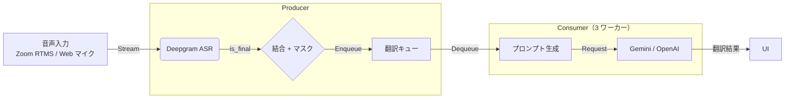

# リアルタイム同時翻訳システム アーキテクチャ設計書

## 1. 概要

Zoom RTMS または Web マイクの音声をリアルタイムに文字起こしし、文脈を加味して翻訳し、
低遅延で表示するパイプラインである。音声認識に Deepgram、翻訳に Gemini または OpenAI を使う。

### 設計目標

1. **低遅延:** 非同期処理でブロッキングを排除する。
2. **文脈の考慮:** 直近の発話を参照し、断片的な入力でも精度を保つ。

## 2. データフロー



## 3. コンポーネント

### 3.1 音声入力

- **Zoom RTMS:** SDK から PCM フレームを取得し、Deepgram へ送信する。
- **Web デモ:** Gradio のマイク入力を `QueueAudioCapture` へ流し、同じパイプラインで処理する。

### 3.2 音声認識（Deepgram）

既定値は `config.py` で定義している。

| パラメータ | 既定値 | 説明 |
|---|---|---|
| `model` | `nova-2-general` | `DEEPGRAM_MODEL` で変更可（`.env.example` は `nova-3-general`） |
| `smart_format` | `true` | 句読点と数値を整形する |
| `endpointing` | `500` | 無音を検知して `is_final` を発行するまでの時間（ms） |
| `utterance_end_ms` | なし | 設定すると UtteranceEnd 受信時に直近の interim を確定扱いにする |
| `interim_results` | `true` | UI の体感速度の改善用。翻訳のトリガーには使わない |

### 3.3 翻訳の文脈（スライディングウィンドウ）

- `is_final` の確定文のみを翻訳する。
- プロンプトでは `<context>` と `<target>` で文脈と翻訳対象を分離する。
- 直近 `CONTEXT_WINDOW_SIZE` 文（既定 5）を保持する。現在の文は翻訳後に追加し、自己参照を避ける。
- 信頼度が低い文は `[uncertain: ...]` でマークする。
- 固有名詞、略語、コード識別子、あいまいな語や未知の語は訳さずに残す。

### 3.4 翻訳エンジン

| 項目 | 内容 |
|---|---|
| Gemini の既定モデル | `gemini-2.5-flash`（`GEMINI_MODEL`） |
| Web UI の動画字幕 | `gemini-3.8-flash`（`VIDEO_GEMINI_MODEL`） |
| OpenAI の既定モデル | `gpt-4o`（`OPENAI_MODEL`） |
| 出力形式 | Structured Output。`latest_slide`（最新の訳）と `kept_terms`（訳さずに残した語） |
| `thinking_budget` | マイクは既定 0（低遅延優先）、動画は 1024（精度優先） |

Gemini の Context Caching は有料プランが必要なため使っていない。キャッシュするのは
プロセス内で生成したシステムプロンプトのみで、`refresh_cache()` で破棄できる。

### 3.5 キューと並列処理

- 翻訳は音声認識の受信ループから独立したワーカー 3 つで実行する。
- 結果はシーケンス番号順にコミットし、並列でも文脈の順序を保つ。
- `TRANSLATION_QUEUE_SIZE`（既定 10）を超えたら古い文を破棄し、最新の文を優先する。

### 3.6 品質向上の機能

いずれも `.env` で切り替えられる。既定で OFF の機能は、有効にする前に
`evaluation/run_benchmark.py` で before/after を比較する。

| 機能 | 環境変数 | 既定 | 実装 |
|---|---|---|---|
| 分断された発話の結合 | `MERGE_UTTERANCES` | ON | `transcription/utterance_merge.py` |
| 文末の未完了検出（LLM） | `INCOMPLETE_END_DETECTION_ENABLED` | ON | `transcription/incomplete_end_detector.py` |
| 訳し漏れの検出 | `COMPLETENESS_CHECK_ENABLED` | ON | `translation/completeness_check.py` |
| Deepgram キーワードブースト | `DEEPGRAM_KEYWORD_BOOST_ENABLED` | OFF | `translation/dictionary.py` |
| Whisper による再検証 | `WHISPER_REVERIFY_ENABLED` | OFF | `transcription/whisper_reverify.py` |
| 不自然度によるチャンク延長（マイクのみ） | `UNNATURALNESS_CHECK_ENABLED` | OFF | `transcription/naturalness_detector.py` |

## 4. エッジケースと対策

| 事象 | 対策 |
|---|---|
| 翻訳の遅延 | キューがあふれたら古い文を破棄し、最新を優先する |
| ハルシネーション | `<context>` と `<target>` のタグで文脈と翻訳対象を分離する |
| 辞書の更新 | キャッシュ済みのシステムプロンプトを破棄して再生成する |

## 5. Docker マイクロサービス構成

Zoom の音声を RTMP で受け、字幕を WebSocket で配信する構成である。構成の定義は
`docker-compose.yml` を参照する。

```text
Zoom
↓ RTMP
Node-Media-Server
↓ PCM (16kHz, mono)
Deepgram ASR
├─ WebSocket（音声認識の字幕を即時配信）
└─ HTTP（非同期）
   ↓
   翻訳 API
   ↓
   WebSocket（翻訳字幕を更新）
```

| サービス | 役割 |
|---|---|
| `nms` | RTMP の受信と中継 |
| `ngrok` | RTMP ポートをインターネットに公開 |
| `deepgram` | 音声認識。interim の結果を即時配信 |
| `gemini` | 翻訳専用のステートレス API（FastAPI）。文脈はリクエストで受け取る |
| `ws` | 字幕配信（FastAPI + WebSocket） |
| `ws-debug` | メッセージ確認用（`debug` プロファイルのみ） |

### 音声の取得

ffmpeg でバッファを切って PCM に変換する。チャンクの既定は 20ms（`FFMPEG_CHUNK_MS`）。

```bash
ffmpeg -fflags nobuffer -flags low_delay \
 -i rtmp://nms:1935/live/zoom \
 -f s16le -ar 16000 -ac 1 -
```

### 字幕の配信

エンドポイントは `ws://<host>:8001/ws/caption` である（コンテナ内のポートは 8000）。

```json
{
  "type": "asr_partial",
  "text": "Hello",
  "confidence": 0.98,
  "is_final": false,
  "ts": 1760000000.0,
  "session_id": "example"
}
```

```json
{
  "type": "translation",
  "src": "Hello",
  "translated": "こんにちは",
  "kept_terms": [],
  "is_final": true,
  "ts": 1760000000.0,
  "session_id": "example"
}
```

### 遅延を抑える原則

- 音声認識と翻訳を直列にしない。interim は即座に配信し、翻訳は後から更新する。
- WebSocket は 1 ホップにする。
- RTMP のバッファを切る。

| 区間 | 遅延の目安（設計時の想定で、実測値ではない） |
|---|---|
| RTMP → PCM | 20–40ms |
| ASR interim | 80–150ms |
| WebSocket | <10ms |
| 翻訳 | 200–400ms |

## 6. 今後の拡張候補

- **RAG:** 用語辞書や会議録のベクトル検索を導入し、用語を動的に注入する。
- **話者分離:** 発話者の情報を文脈に含め、口調の一貫性を高める。
- **代替 ASR:** faster-whisper は `transcription/whisper_client.py` で導入済み。Aqua Voice や AssemblyAI にも切り替えられるよう抽象化する。
- **低遅延化:** RTMP を廃止して WebRTC に移行する。
- **スケール:** Redis や Kafka で複数の会議に対応する。
- **議事録:** Gemini で要約や議事録を生成する。
- **字幕 UI:** React や Svelte で字幕専用の Web UI を作る。
