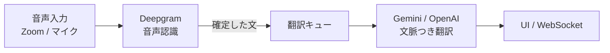

# Real-time Translation

動画への日本語字幕の自動生成と、音声のリアルタイム翻訳を行うツールです。
音声認識に [Deepgram](https://deepgram.com/)、翻訳に Gemini または OpenAI を使います。

> [!IMPORTANT]
> **アプリ本体のコードは `master` ブランチにあります。** `main` ブランチにあるのはこの README と `Lancher.py` だけで、`main` 単体では起動できません。

## 目次

- [できること](#できること)
- [クイックスタート（Windows）](#クイックスタートwindows)
- [使い方](#使い方)
- [環境変数](#環境変数)
- [開発者向け](#開発者向け)
- [Docker 構成（Zoom 連携）](#docker-構成zoom-連携)
- [アーキテクチャ](#アーキテクチャ)
- [トラブルシューティング](#トラブルシューティング)

## できること

| 機能 | 説明 |
|---|---|
| 動画字幕の生成 | 動画を文字起こし・翻訳し、字幕付き MP4 と SRT ファイルを出力 |
| マイクのリアルタイム翻訳 | ブラウザのマイク入力を文字起こしし、その場で翻訳 |
| 音声ファイルの翻訳 | WAV・MP3 などをアップロードして翻訳 |
| Zoom のリアルタイム翻訳 | Zoom の音声を翻訳し、WebSocket や Zoom 字幕に配信 |

## クイックスタート（Windows）

**動作環境:** Windows 10 / 11、インターネット接続

Python を事前にインストールする必要はありません。初回起動時に uv、Python 3.13、ライブラリ、ffmpeg が自動でセットアップされます。

### 1. API キーを用意する

どちらも無料枠から始められます。

| サービス | 用途 | 取得先 |
|---|---|---|
| Deepgram | 音声認識 | [console.deepgram.com](https://console.deepgram.com/) |
| Google AI (Gemini) | 翻訳 | [aistudio.google.com/apikey](https://aistudio.google.com/apikey) |

> [!CAUTION]
> API キーは他人に見せたり、README などの Git 管理下のファイルに書いたりしないでください。

### 2. ダウンロードして起動する

```bash
git clone -b master https://github.com/yaguangxiaocang-jpg/real_time_transalation_oguramasahiro.git
```

1. ダウンロードしたフォルダの `launch.bat` をダブルクリックします。初回はセットアップに数分かかります。
2. ブラウザが自動で開きます。開かない場合は <http://localhost:7861> を開いてください。
3. 画面上部の「API Keys」欄に、用意したキーを入力します。

終了するには、タスクトレイのアイコンを右クリックして「終了」を選びます。

<details>
<summary>自動セットアップがうまくいかない場合（手動セットアップ）</summary>

PowerShell で以下を順に実行します。

```powershell
# 1. uv をインストール（終わったら PowerShell を開き直す）
powershell -ExecutionPolicy ByPass -c "irm https://astral.sh/uv/install.ps1 | iex"

# 2. このフォルダで Python とライブラリを準備
uv sync --extra microphone

# 3. ffmpeg をインストール
winget install --id Gyan.FFmpeg -e
```

`winget` が使えない場合は、[ffmpeg のビルド配布ページ](https://www.gyan.dev/ffmpeg/builds/)から `ffmpeg-release-essentials.zip` を入手して解凍し、中の `bin` フォルダを環境変数 `Path` に追加してください。

</details>

## 使い方

### 動画に字幕を付ける

1. 「🎬 動画字幕」タブを開きます。
2. 動画ファイルをドラッグ＆ドロップします。
3. 「ドメイン」で動画の分野を選びます（迷ったら `general`）。
4. 「🎬 字幕を生成する」をクリックします。
5. 完了したら、字幕付き動画と SRT ファイルをダウンロードします。

処理時間は、Gemini の無料枠だと動画の長さと同じくらいが目安です（90 分の動画で約 90 分）。

| 出力ファイル | 用途 |
|---|---|
| 字幕付き動画（MP4） | そのまま共有・配信に使う |
| SRT ファイル | YouTube Studio の「字幕」→「ファイルをアップロード」などで使う |

### マイクをリアルタイム翻訳する

1. 「🎤 Microphone」タブを開きます。
2. 「Start」をクリックしてマイクに向かって話すと、文字起こしと翻訳が表示されます。
3. 終わったら「Stop」をクリックします。

## 環境変数

コマンドラインや Docker で使う場合は、`.env` に設定します。

```bash
cp .env.example .env
```

`.env` は `.gitignore` の対象です。実際のキーは `.env` にだけ書き、`.env.example` には書かないでください。

### 基本

| 変数名 | 説明 | 必須 |
|---|---|---|
| `DEEPGRAM_API_KEY` | Deepgram の API キー | ✓ |
| `LLM_PROVIDER` | `gemini` または `openai`（既定: `gemini`） | |
| `GOOGLE_API_KEY` | Google AI の API キー | Gemini 使用時 |
| `OPENAI_API_KEY` | OpenAI の API キー | OpenAI 使用時 |
| `ZOOM_CLIENT_ID` / `ZOOM_CLIENT_SECRET` | Zoom RTMS の認証情報 | Zoom RTMS 使用時 |
| `SOURCE_LANGUAGE` / `TARGET_LANGUAGE` | 翻訳元・翻訳先の言語コード（例: `en` / `ja`） | |
| `TRANSLATION_DOMAIN` | 翻訳ドメイン（実験記録用） | |
| `CONTEXT_WINDOW_SIZE` | 文脈として保持する文数 | |
| `TRANSLATION_QUEUE_SIZE` | 翻訳キューのサイズ | |
| `DICTIONARY_PATH` | 用語辞書 CSV のパス | |

<details>
<summary>Deepgram の詳細設定</summary>

| 変数名 | 説明 |
|---|---|
| `DEEPGRAM_MODEL` | モデル名 |
| `DEEPGRAM_ENDPOINTING` | 無音を検知して確定するまでの時間（ms） |
| `DEEPGRAM_UTTERANCE_END_MS` | 発話終了の検知時間（ms）。設定すると UtteranceEnd イベントで直近の interim 結果を確定扱いにする |
| `DEEPGRAM_INTERIM_RESULTS` | interim 結果の出力有無 |
| `DEEPGRAM_SMART_FORMAT` | smart_format の有無 |
| `DEEPGRAM_VAD_EVENTS` | VAD イベントの有無 |

</details>

<details>
<summary>マイクロサービス用の追加設定</summary>

| 変数名 | 説明 | 必須 |
|---|---|---|
| `RTMP_URL` | NMS の RTMP 入力 URL | ✓ |
| `WS_PUBLISH_URL` | WS サービスへの Publish URL | ✓ |
| `TRANSLATION_API_URL` | 翻訳 API の URL | ✓ |
| `NGROK_AUTHTOKEN` | ngrok の認証トークン | ngrok 使用時 |
| `ZOOM_CAPTION_URL` | Zoom 字幕 API の URL | |
| `ZOOM_CAPTION_LANG` | Zoom 字幕の言語コード | |
| `ASR_SEND_INTERIM` | ASR の interim を WS へ送信するか | |
| `TRANSLATE_INTERIM` | interim を翻訳へ送信するか | |
| `ASR_PARTIAL_MIN_INTERVAL_MS` | interim の送信間隔（ms） | |
| `TRANSLATION_CONCURRENCY` | 翻訳の同時実行数 | |
| `HTTP_TIMEOUT` | HTTP タイムアウト（秒） | |

- `DICTIONARY_PATH` の CSV の `source_term` 列は、Deepgram の [Keyterm Prompting](https://developers.deepgram.com/docs/keyterm) に渡され、専門用語の認識精度を高めます。
- `ZOOM_CAPTION_URL` を設定すると、翻訳結果が Zoom の字幕に表示されます。URL の取得方法は [Zoom サポート](https://support.zoom.com/hc/en/article?id=zm_kb&sysparm_article=KB0060372)を参照してください。

</details>

## 開発者向け

パッケージ管理には [uv](https://docs.astral.sh/uv/) を使います（Python 3.13）。

```bash
uv sync --extra dev                # 依存関係のインストール
uv run real-time-translation       # Zoom RTMS 向け CLI（要 --extra zoom）
uv run real-time-translation-demo  # Web デモ（Zoom 認証は不要）
python add_subtitles.py <動画>      # 動画字幕をコマンドラインで生成

uv run pytest                      # テスト
uv run ruff format .               # フォーマット
uv run ruff check .                # リント
```

<details>
<summary>マイクロサービスを単体で起動する</summary>

各サービスは独立したパッケージです。リポジトリのルートから、サービスごとに別のターミナルで実行します。

```bash
cd services/ws && uv sync && uv run real-time-translation-ws
cd services/translator && uv sync && uv run real-time-translation-translate
cd services/asr && uv sync && uv run real-time-translation-asr
```

</details>

### プロジェクト構成（`master` ブランチ）

```text
├── src/real_time_translation/
│   ├── audio/capture.py                 # 音声取得
│   ├── transcription/deepgram_client.py # Deepgram 文字起こし
│   ├── translation/llm_translator.py    # Gemini / OpenAI 翻訳
│   ├── config.py                        # 設定管理
│   ├── gradio_demo.py                   # Web UI
│   ├── main.py                          # CLI エントリーポイント
│   └── pipeline.py                      # パイプライン統合
├── services/                            # マイクロサービス（asr / translator / ws）
├── evaluation/                          # 翻訳品質の評価スクリプト
├── experiments/                         # 実験記録
├── tests/                               # テスト
├── add_subtitles.py                     # 動画字幕の生成スクリプト
├── launch.bat / setup.bat               # Windows 用の起動・セットアップ
└── docker-compose.yml                   # マイクロサービス構成
```

## Docker 構成（Zoom 連携）

```bash
docker compose up --build
```

| サービス | 役割 |
|---|---|
| `nms` | Node-Media-Server（RTMP 受信） |
| `ngrok` | RTMP ポートをインターネットに公開 |
| `deepgram` | RTMP の音声を Deepgram で認識し、結果を WS と翻訳へ中継 |
| `gemini` | 翻訳 API（FastAPI） |
| `ws` | 字幕配信用 WebSocket（FastAPI） |

| エンドポイント | URL |
|---|---|
| RTMP 入力 | `rtmp://localhost:1935/live/zoom` |
| 字幕 WebSocket | `ws://localhost:8001/ws/caption` |
| NMS 管理画面 | `http://localhost:8000/admin` |
| ngrok ダッシュボード | `http://localhost:4040` |

<details>
<summary>ngrok の設定（Zoom カスタムストリーミング用）</summary>

1. [ngrok ダッシュボード](https://dashboard.ngrok.com/get-started/your-authtoken)で認証トークンを取得します。
2. TCP トンネルの利用に必要なため、[設定ページ](https://dashboard.ngrok.com/settings#id-verification)でクレジットカードを登録します（課金はされません）。
3. `.env` に `NGROK_AUTHTOKEN` を設定します。
4. トンネルの URL を確認します。

   ```bash
   curl -s http://localhost:4040/api/tunnels | jq '.tunnels[0].public_url'
   # 例: tcp://0.tcp.jp.ngrok.io:12345
   ```

5. Zoom に次のように設定します。
   - Streaming URL: `rtmp://0.tcp.jp.ngrok.io:12345/live`
   - Streaming Key: `zoom`

</details>

<details>
<summary>デバッグモード（WebSocket のメッセージを確認）</summary>

```bash
docker compose --profile debug up -d    # 起動
docker compose logs -f ws-debug         # ログ確認
docker compose --profile debug down     # 停止
```

`ws-debug` は `profiles: [debug]` で定義されているため、停止時にも `--profile debug` が必要です。

</details>

## アーキテクチャ



- **低遅延:** 音声認識と翻訳を非同期で分離します。キューがあふれたら古い文を捨て、最新の文を優先します。
- **文脈つき翻訳:** 直近の文を文脈としてプロンプトに含めます。文脈と翻訳対象はタグで分離します。
- **固有名詞の保持:** 人名や略語、意味があいまいな語は訳さずに残します。
- **用語辞書:** 用語辞書をシステムプロンプトに含めて、訳語を揃えます。

詳しくは `master` ブランチの `DESIGN_DOC.md` を参照してください。

## トラブルシューティング

| 症状 | 対処 |
|---|---|
| 動画をアップロードできない | アプリを再起動します。解決しなければ、ブラウザのキャッシュをクリアするか別のブラウザを試します |
| 「APIキーが未設定です」と表示される | 画面上部の「API Keys」欄にキーが入力されているか確認します |
| 翻訳が途中で止まる | Gemini 無料枠のレート制限の可能性があります。少し待って再試行します |
| `ffmpeg` が見つからない | `ffmpeg -version` で確認し、エラーになる場合はインストールと `Path` の設定を確認します |
| アプリが起動しない | プロジェクトフォルダの `launcher_error.log` を確認します |

問題が解決しない場合は、操作手順、エラーメッセージ、`launcher_error.log` の内容を添えて報告してください。
